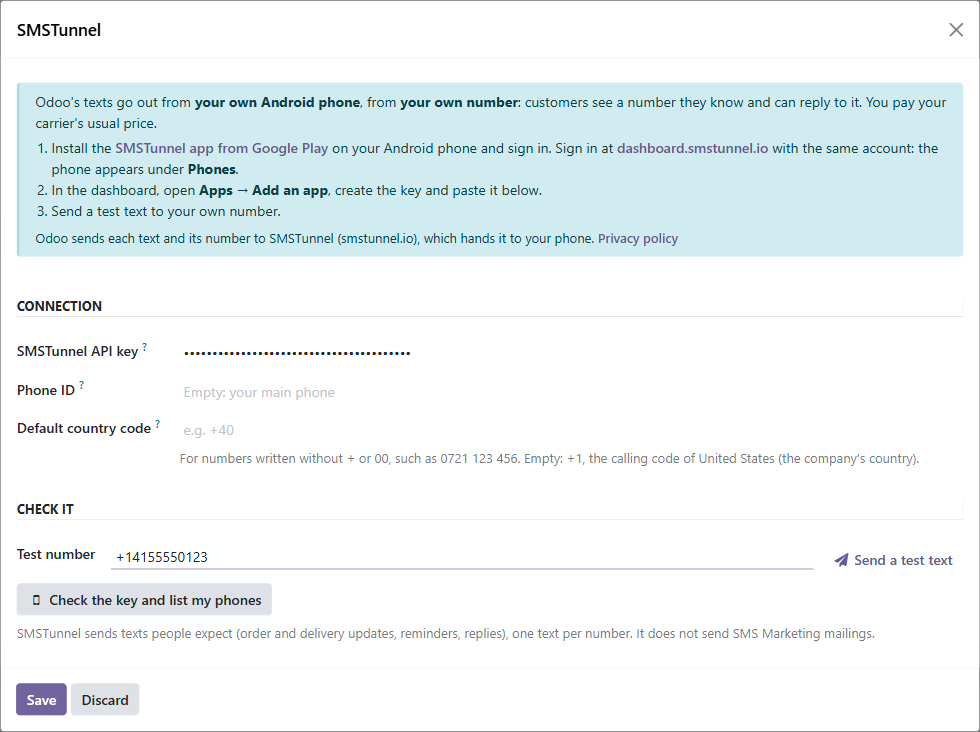
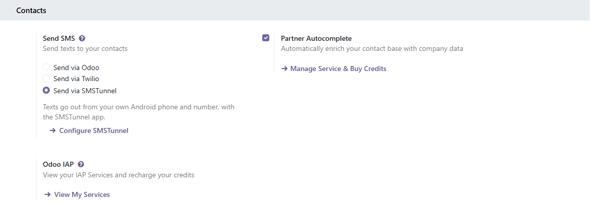

# SMSTunnel SMS for Odoo

An Odoo module (`sms_smstunnel`) that sends **Odoo's own texts** through **[SMSTunnel](https://smstunnel.io)**: from **your own Android phone**, from **your own number**.

In **Settings → General Settings → Send SMS** you choose **Send via SMSTunnel**, next to Odoo's *Send via Odoo* and *Send via Twilio*. From then on, every text Odoo sends for that company — the SMS button of a contact, SMS templates such as the delivery confirmation of Inventory, automated actions, calendar and event reminders — goes to your SMSTunnel account, and your phone sends it from its own SIM. Customers see a number they know and can reply to it, and each text costs what your carrier charges.

Your phone needs the SMSTunnel app from Google Play:

<a href="https://play.google.com/store/apps/details?id=io.smstunnel.app"></a>



## Contents

- [Requirements](#requirements)
- [Install](#install)
- [Set it up](#set-it-up)
- [What Odoo shows](#what-odoo-shows)
- [SMS Marketing is not supported](#sms-marketing-is-not-supported)
- [Good to know](#good-to-know)
- [For developers](#for-developers)
- [Build it with an AI assistant](#build-it-with-an-ai-assistant)
- [Tests](#tests)
- [Repository layout](#repository-layout)
- [Responsible use](#responsible-use)
- [License](#license)

## Requirements

- **Odoo 17.0, 18.0 or 19.0**, Community or Enterprise, **on Odoo.sh or on your own server**. Odoo Online does not install third-party modules, so it can't use this one.
- An Odoo build from **September 2025 or later**. The module plugs into the SMS provider choice that Odoo added then with its core *Twilio SMS* module (`sms_twilio`); Odoo installs that module together with this one. Odoo.sh is always recent; on your own server, update Odoo if `sms_twilio` is missing.
- An **Android phone** with the [SMSTunnel app](https://play.google.com/store/apps/details?id=io.smstunnel.app), signed in to your SMSTunnel account.

## Install

Pick the branch (or, on `main`, the folder) that matches your Odoo version: `17.0`, `18.0` or `19.0`. Each contains the module folder `sms_smstunnel`.

**Odoo.sh**

1. Add this repository to your Odoo.sh project as a submodule, on the branch of your version (Odoo.sh adds submodule folders to the addons path):

   ```bash
   git submodule add -b 17.0 https://github.com/narcisbodea/smstunnel-odoo.git smstunnel-odoo
   git commit -m "Add SMSTunnel SMS" && git push
   ```

   Or copy the `sms_smstunnel` folder of your version into your project repository.
2. When the build is ready: **Apps → Update Apps List**, search for **SMSTunnel**, click **Activate**.

**Your own server**

1. Copy the `sms_smstunnel` folder of your version into a folder listed in `addons_path`, and restart Odoo.
2. **Apps → Update Apps List** (developer mode), search for **SMSTunnel**, click **Activate**.

From the Odoo Apps store, the download is the same `sms_smstunnel` folder.

## Set it up

1. Install the SMSTunnel app from Google Play on your Android phone and sign in. Sign in at [smstunnel.io](https://smstunnel.io) on your computer with the same account: the phone appears under **Phones** (you can also link it with **Phones → Add phone**).
2. In your [SMSTunnel dashboard](https://dashboard.smstunnel.io/apps), open **Apps → Add an app**, pick **Odoo** and click **Create the key**. Copy the key: it is shown only once. It can send texts and look up their status.
3. In Odoo, open **Settings → General Settings**, find **Send SMS** (under *Contacts*), choose **Send via SMSTunnel** and click **Configure SMSTunnel**:

   | Field | What it does |
   | --- | --- |
   | **SMSTunnel API key** | The key from step 2. Only Settings administrators can read it; it is shown masked. |
   | **Phone ID** | Optional. Which of your phones sends the texts; empty means your main phone. A phone's ID is shown under **Phones** in the dashboard, with a Copy button. |
   | **Default country code** | Optional. Completes numbers written without `+` or `00`, such as `0721 123 456`. Empty: the calling code of the company's country. |

4. Type your own number under **Test number** and click **Send a test text**. **Check the key and list my phones** shows the phones of the account and whether they are online.
5. **Save**.

Each company chooses its own provider, so in a multi-company database one company can use SMSTunnel while another keeps Odoo's credits or Twilio.



## What Odoo shows

Each text gets its own request, one number at a time, and Odoo shows the result the way it does for its own providers (in the chatter, and under **Settings → Technical → SMS** in developer mode):

| What happened | Odoo shows |
| --- | --- |
| SMSTunnel took the text and your phone is online | **Sent** |
| SMSTunnel took the text but your phone is offline | **Processing**: SMSTunnel keeps the text (up to 3 days) and your phone sends it when it is back |
| The phone reported delivery | **Delivered** |
| The phone could not send it | **Error** — *Not Delivered*, with the phone's reason |
| SMSTunnel refused the key, or the key may not send | **Error** — *Unregistered Account* |
| Your SMSTunnel plan doesn't cover the text | **Error** — *Insufficient Credit* |
| SMSTunnel refused the number (wrong format, premium-rate, satellite) | **Error** — *Wrong Number Format* |
| No API key in the settings yet | **Error** — *Unregistered Account* ("SMSTunnel isn't set up yet") |
| Anything else SMSTunnel refused (the text is too long, the Phone ID is wrong, ...) | **Error** — *Unknown error*, with SMSTunnel's words |
| SMSTunnel couldn't be reached, failed, or asked to slow down | **In Queue**: the text waits in Odoo's queue (see below) |

The precise reason is kept on the text (**SMSTunnel failure reason** on the SMS form and list), and on Odoo 17 and 18 it is also shown in the chatter's *Sending Failures* dialog, where **Send & Close** resends the text once the problem is fixed.

A cron (**SMSTunnel: follow the status of sent texts**, every 10 minutes) checks the texts SMSTunnel took: *Processing* becomes *Sent* when the phone sends it, *Sent* becomes *Delivered* when a delivery report comes back, and a text the phone could not send becomes an error. It follows a waiting text for 3 days and a sent one for 24 hours, at most 50 checks per run.

**When SMSTunnel can't take texts.** If SMSTunnel can't be reached, answers with a server error, or asks to slow down (it takes 30 texts a minute), the text stays **In Queue** and nothing crashes. The company's texts then wait, and Odoo's **SMS: SMS Queue Manager** cron is scheduled to run again: after 1, 2, 5, 10, 30 and then every 60 minutes while the problem lasts, or after the time SMSTunnel gave for slowing down. A text that still can't be sent after 8 tries is marked **Error** — *Server Error*; resend it from the chatter. **Send a test text** in the settings resumes the queue right away when it works.

## SMS Marketing is not supported

Texts of an **SMS Marketing** mailing, and its **Test** button, are refused and marked as failed with this reason:

> SMSTunnel sends texts people expect, one at a time; use it for transactional texts, not SMS marketing.

SMSTunnel sends each text from your own SIM, and carriers expect a personal or business SIM to send texts that people asked for: order and delivery updates, reminders, answers. In a company that sends SMS Marketing mailings, keep Odoo's credits or Twilio for that company.

## Good to know

- **What Odoo sends to SMSTunnel**: each text, its number, and the Phone ID and country code you set. Nothing else from your database. See the [privacy policy](https://smstunnel.io/privacy).
- **Numbers**: Odoo already formats numbers with the country of the contact or the company. Numbers it can't format go as they are, and the default country code completes the local ones.
- **Length**: up to 1600 characters per text (10 joined SMS).
- **Your API key** is stored on the company record, readable only by Settings administrators, shown masked, and never written to the logs. Odoo has no encrypted storage: anyone with direct access to the database or its backups can read it. Create one key per database in your SMSTunnel dashboard, and delete a key there to cut that database off at once.
- **Copies of the database** made by Odoo.sh for staging or development, or by `odoo-bin neutralize`, lose the key, so a copy never texts real customers. Add a test key there if you need one.
- **Automated actions**: an action with the trigger *On create and edit* runs again on every save of a record that still matches. Set a *Before update* filter (or *When updating* fields) so the rule fires once, or each save sends another text.
- **Uninstalling** the module switches the companies that used SMSTunnel back to *Send via Odoo*.

## For developers

Texts created in code go through the provider of their company, like any other:

```python
self.env['sms.sms'].sudo().create({'number': '+14155550123', 'body': 'Your order is ready.'}).send()
```

**Sign-in codes.** Odoo itself sends no sign-in codes by SMS (its own verification codes go through Odoo's servers). For a custom module that does, set `smstunnel_sign_in_code` on the text: SMSTunnel then sends it through its sign-in code service, with a separate daily allowance. The text must contain the code as 4 to 10 digits standing on their own (like `482913`, or `123-456`) and be at most 320 characters.

```python
self.env['sms.sms'].sudo().create({
    'number': '+14155550123',
    'body': 'Your sign-in code is 482913',
    'smstunnel_sign_in_code': True,
}).send()
```

How the module plugs in: `res.company._get_sms_api_class()` returns `SmsApiSmsTunnel` (`tools/sms_api.py`, built on Odoo's `SmsApiBase` like the core Twilio provider), and `sms.sms._split_by_api()` hands each company's texts to its provider. The HTTP calls are in `tools/smstunnel_client.py`. The server address is `https://smstunnel.io`; for tests only, the system parameter `sms_smstunnel.server_url` points it elsewhere.

## Build it with an AI assistant

Paste this into Claude, ChatGPT, Cursor or Copilot and replace the part in brackets. Don't paste your API key into the chat: the prompt doesn't need it.

```text
Help me set up Odoo so that it texts people from my own phone with SMSTunnel.

About SMSTunnel (https://smstunnel.io): my own apps and tools hand text messages (SMS) to my
SMSTunnel account, and my own Android phone sends them from my own number, on my own SIM and plan.
The phone runs the SMSTunnel app from Google Play
(https://play.google.com/store/apps/details?id=io.smstunnel.app), signed in to my account.

What I want: [describe what should send a text, to whom, and when]

How it works in Odoo:
- The module "SMSTunnel SMS" (technical name sms_smstunnel, https://github.com/narcisbodea/smstunnel-odoo)
  works on Odoo 17.0, 18.0 and 19.0, on Odoo.sh or self-hosted (Odoo Online cannot install it). Install
  the folder of my version, then Apps -> Update Apps List -> SMSTunnel -> Activate. It needs Odoo's core
  "Twilio SMS" module (sms_twilio, in Odoo builds from September 2025), which Odoo installs with it.
- Settings -> General Settings -> Send SMS -> "Send via SMSTunnel" -> "Configure SMSTunnel": API key,
  optional Phone ID (which phone sends; empty = my main phone), Default country code (completes numbers
  written without + or 00; empty = the company's country). "Send a test text" checks the setup.
- Then everything in Odoo that sends texts for that company goes through my phone: the SMS button of a
  contact or record, SMS templates (e.g. Inventory -> Settings -> SMS confirmation of deliveries),
  automated actions with the "Send SMS" action, calendar and event reminders. Each company chooses its
  provider.
- Statuses in Odoo: Sent; Processing when my phone is offline (the text waits up to 3 days and goes out
  when the phone is back); Delivered; Error with SMSTunnel's reason. If SMSTunnel can't be reached or
  asks to slow down, texts wait in Odoo's queue and the "SMS: SMS Queue Manager" cron sends them later;
  after 8 failed tries a text becomes "Server Error".
- SMS Marketing mailings are refused (marked failed). Automated actions on create-and-edit need a
  "Before update" filter, or every save sends another text.
- In custom code: create sms.sms records (number, body) and call send(); for a sign-in code also set
  smstunnel_sign_in_code=True.

SMSTunnel API facts (what the module calls, for anything custom):
- POST https://smstunnel.io/api/v1/sms/send with the headers "X-API-Key: <key>" and
  "Content-Type: application/json", and the JSON body {"to": "+14155550123", "message": "..."}.
  Optional: "deviceId" (which phone sends it) and "defaultCountryCode" ("44", "+44" or "0044": completes
  numbers written without + or 00 and always wins). Other fields are refused with 400.
- One recipient per call: to text several people, make one call per number. Up to 1600 characters.
- Sign-in codes: POST https://smstunnel.io/api/v1/sms/send-2fa, same fields. The text must contain the
  code as 4 to 10 digits standing on their own (or 123-456) and be at most 320 characters, otherwise
  400 "No valid verification code found". Separate daily allowance.
- Answers: 200 {"success": true, "messageId": "...", "queued": true|null}. queued = my phone is offline:
  the text waits and goes out when it is back. 400 bad input; 401 missing or invalid key; 403 the key
  lacks a permission ("code": "PERMISSION_REQUIRED") or my plan doesn't include it; 429 too many
  requests (30 sends a minute; wait for Retry-After); 5xx: retry later, a few times at most.

Rules for your answer:
- Do not ask for my SMSTunnel password or API key and do not put a real key in your answer; I will not
  paste it in this chat. In Odoo the key belongs in the SMSTunnel settings, and in any custom code in an
  environment variable or Odoo's settings, never in source code or in a browser.
- Phone numbers must be in international format (+ and the country code); validate them.
- Handle errors: show what failed, retry only after 429, 5xx or network errors, and never send the same
  text twice.
- Help me test it with my own number first.
- Only send texts people expect from me. No unsolicited texts.
```

## Tests

The module's tests run in Odoo (`--test-tags /sms_smstunnel`): SMSTunnel's answers are mocked, and one class (`TestSmsTunnelLocalApi`) runs end to end against a real SMSTunnel server when `SMSTUNNEL_E2E_URL` and `SMSTUNNEL_E2E_KEY` are set. `tests/e2e/` has a Docker stack with Odoo 17, 18 and 19 and scripts for the tests and for real Odoo flows (a contact's SMS, a delivery confirmation, an automated action, SMS Marketing, a wrong key, a refused number, SMSTunnel down and back, an offline phone, the status cron, a sign-in code):

```bash
docker compose -p smst-int-odoo -f tests/e2e/docker-compose.yml up -d db
SMSTUNNEL_KEY_FILE=/path/to/test-key.json tests/e2e/run-tests.sh 17     # or 18, 19
SMSTUNNEL_KEY_FILE=/path/to/test-key.json tests/e2e/run-flows.sh 17     # real flows, in odoo shell
node tests/e2e/check-mongo.mjs "[odoo17]"                               # what a local test server received
docker compose -p smst-int-odoo -f tests/e2e/docker-compose.yml down -v
```

The key file is JSON with an `apiKey` field; the scripts read it and never print it. Point them only at a test server, never at production.

## Repository layout

```
17.0/sms_smstunnel/   the module for Odoo 17.0
18.0/sms_smstunnel/   the module for Odoo 18.0
19.0/sms_smstunnel/   the module for Odoo 19.0
tests/e2e/            Docker stack and scripts for local tests
tools/                store page template, release branches
```

The three folders differ only where Odoo does (the cron's fields, the batch size method renamed in 19, `res.partner.mobile` gone in 19, the *Sending Failures* dialog removed in 19). For the Odoo Apps store each version is published from its own branch; `tools/make-release-branches.sh` creates the branches `17.0`, `18.0` and `19.0` from these folders. See [PUBLISHING.md](PUBLISHING.md).

## Responsible use

Send only texts that people expect from you: order and delivery updates, appointment reminders, answers to their questions. Unsolicited messages from a personal SIM break most carriers' terms of service. Please make sure your usage complies with your carrier's terms and with local regulations (in the EU, that includes GDPR and ePrivacy rules on electronic communications).

## License

[LGPL-3](LICENSE), the license of Odoo Community and of its core SMS modules, which this module extends. LGPL-3 lets anyone use the module in any Odoo database, including alongside Odoo Enterprise and proprietary modules; changes to the module itself stay under LGPL-3. It is also the license the Odoo Apps store recommends for open-source apps.

SMSTunnel for Odoo is made by NARBOWEB SRL. It is not affiliated with, endorsed by, or sponsored by Odoo S.A. Odoo is a trademark of Odoo S.A.
